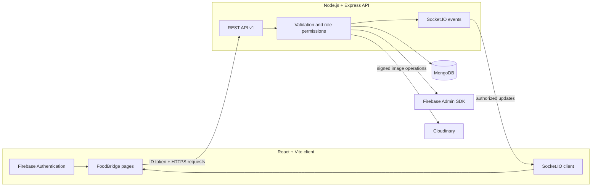
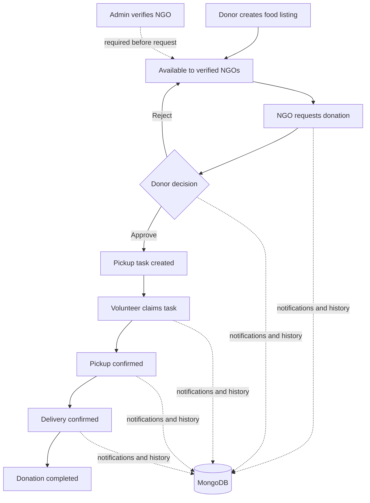

# FoodBridge

FoodBridge helps donors share surplus food with verified NGOs, with volunteers handling pickup and delivery. This repository contains a React web app and a Node/Express API.

> Demo mode is for local presentations. It skips authentication and stores demo workflow data in this browser's local storage. It does not call the API or save data to MongoDB.

## How the app fits together



MongoDB is the source of truth for real accounts and donation workflows. Socket.IO tells authorized clients when to refresh persisted state. Cloudinary handles optional food images. The current app stores location coordinates, but does not yet display a Google Map or use Google Maps geocoding.

## Donation workflow



## Project layout

```text
FoodBridge/
├── client/                 # React, TypeScript, Vite, Tailwind, React Router
│   └── src/
│       ├── components/     # Shared UI, navigation, protected routes
│       ├── contexts/       # Authentication and real-time connection
│       ├── demo/           # Browser-local demo storage
│       ├── pages/          # Public and role-based pages
│       └── services/       # API and Firebase client integration
├── server/                 # Express, TypeScript, Mongoose, Socket.IO
│   └── src/
│       ├── config/         # Environment and service setup
│       ├── controllers/    # HTTP handlers
│       ├── middleware/     # Auth, validation, errors and logging
│       ├── models/         # MongoDB models and indexes
│       ├── routes/         # Versioned API routes
│       └── services/       # Workflow rules and business operations
├── .env.example
├── netlify.toml            # Frontend hosting and SPA fallback
└── render.yaml             # API hosting blueprint
```

## Run locally

### Requirements

- Node.js 20+ and npm 10+
- MongoDB replica set (Atlas works) for database-backed workflows
- Firebase project for real sign-in
- Cloudinary account for image uploads

### Install and start

```sh
npm ci
cp .env.example .env
npm run dev
```

In PowerShell, copy the environment file with:

```powershell
Copy-Item .env.example .env
```

The web app runs at [http://localhost:5173](http://localhost:5173). The API runs at [http://localhost:4000](http://localhost:4000). Health check: [http://localhost:4000/api/v1/health](http://localhost:4000/api/v1/health).

With no external credentials, public pages and the development-only demo remain available. A demo walkthrough is available at `/login`: choose donor, NGO, volunteer, or admin, then follow the dashboard steps. Create a donation, verify the demo NGO, request and approve it, and complete pickup and delivery. Data survives refresh and role switches in the same browser. Demo state is isolated from Firebase and MongoDB.

## Configure real services

Copy `.env.example` to `.env` and set the values below. The example contains variable names only; never commit `.env` or credential files.

| Variables | Purpose |
| --- | --- |
| `NODE_ENV`, `PORT`, `CLIENT_ORIGIN` | API runtime and allowed frontend origins |
| `MONGODB_URI` | MongoDB connection string; use a replica set for transactions |
| `FIREBASE_PROJECT_ID`, `FIREBASE_SERVICE_ACCOUNT_PATH` | Firebase Admin server credentials; keep the service-account JSON outside this repository |
| `VITE_FIREBASE_API_KEY`, `VITE_FIREBASE_AUTH_DOMAIN`, `VITE_FIREBASE_PROJECT_ID`, `VITE_FIREBASE_APP_ID` | Firebase Web app configuration for client sign-in |
| `VITE_API_URL` | Optional API base URL; local Vite proxy is used if omitted |
| `CLOUDINARY_CLOUD_NAME`, `CLOUDINARY_API_KEY`, `CLOUDINARY_API_SECRET`, `CLOUDINARY_UPLOAD_PRESET` | Signed image uploads; API secret stays on the server |
| `GOOGLE_MAPS_API_KEY`, `VITE_GOOGLE_MAPS_API_KEY` | Reserved for Maps integration; the app currently does not make Maps API calls |
| `ADMIN_BOOTSTRAP_FIREBASE_UID` | Temporary, one-time initial admin bootstrap only |

Firebase setup: create a Firebase project and Web app, enable Email/Password under Authentication, add localhost and deployed domains to Authorized domains, and configure the Web app values above. For the API, provide Firebase Admin credentials and MongoDB. The server verifies ID tokens and gets roles from MongoDB; public registration cannot grant admin access.

To create the first administrator, create and verify the operator's Firebase account, confirm the API points at the intended database, set `ADMIN_BOOTSTRAP_FIREBASE_UID` temporarily in a secure shell, and run:

```sh
npm run admin:bootstrap --workspace server
```

Remove the UID immediately afterwards. The bootstrap command refuses to create a second administrator.

Cloudinary credentials are server-only. Restrict upload formats to JPG/PNG/WebP and configure the size limit. If Maps is added later, restrict browser keys by referrer and server keys by host IP and required APIs.

## Useful commands

```sh
npm run dev          # Start API and web client together
npm run typecheck    # Type-check both workspaces
npm test             # Run server and client tests
npm run build        # Production-build API and client
npm run db:indexes   # Create MongoDB indexes
```

API integration and Socket.IO tests bind local ports. Database transaction checks against a live MongoDB instance require a disposable replica-set database; never run destructive test data against production.

## Deployment

The frontend and API deploy as separate services. The root `vercel.json` builds the Vite client workspace and sends client-side routes to its SPA entry point. The API uses the existing Render blueprint in `render.yaml`; the Express process keeps a persistent HTTP server for Socket.IO and connects to MongoDB, so it should run on a long-lived Node host rather than as a Vercel function. The existing `netlify.toml` remains available for Netlify. No deployment has been performed or live-verified.

### Vercel frontend settings

Import this repository in Vercel and use:

| Setting | Value |
| --- | --- |
| Root Directory | `.` (repository root; leave “Include files outside the Root Directory” enabled if shown) |
| Framework Preset | `Vite` |
| Install Command | `npm ci --include=dev` |
| Build Command | `npm run build --workspace client` |
| Output Directory | `client/dist` |

Set the client environment variables in Vercel before building. In particular, set `VITE_API_URL` to the deployed API origin followed by `/api`, for example `https://foodbridge-api.example.com/api` (replace the example with the actual API URL). The client appends `/v1` for REST requests; Socket.IO connects to the same host. Do not set this to `localhost` or a Vercel URL unless the API is actually hosted there. Also set the Firebase Web app values listed in `.env.example` if sign-in is needed. These `VITE_` values are public client configuration, not server secrets.

The rewrite in `vercel.json` is for React Router deep links such as `/donor/dashboard`; it does not proxy `/api` to the backend. API traffic goes directly to `VITE_API_URL`.

### API and shared services

1. Create MongoDB Atlas, restrict network access, create a least-privilege database user, and configure backups.
2. Deploy the API to Render using `render.yaml` (or another persistent Node host) with MongoDB, Firebase Admin, and Cloudinary values in the host's secret settings. Set `CLIENT_ORIGIN` to the exact HTTPS Vercel frontend origin. Render's blueprint expects the environment variable names shown in `render.yaml` and `.env.example`.
3. Run `npm run db:indexes` against the intended database after taking a backup.
4. Add the deployed frontend domain to Firebase Authorized domains. Confirm `https://<api-host>/api/v1/health` reports a connected database before using real workflows.
5. Redeploy the Vercel client after changing any `VITE_` environment value; Vite embeds these values at build time.

Production startup requires valid service configuration and HTTPS CORS origins. Use your hosting provider's secret manager; do not put server credentials in `VITE_` variables.

## Current limitations

- Google Maps rendering and geocoding are not implemented. Distance filtering needs stored coordinates.
- Analytics currently report record counts; they do not normalize food quantities with different units.
- The local demo is browser-only and is not suitable for real accounts or production data.
- There is no live deployment configured or verified.

## Troubleshooting

- API health returns `503`: check `MONGODB_URI`, Atlas network allow-list, credentials, and replica-set availability.
- Sign-in is unavailable: check Firebase Web values, Email/Password provider, Authorized domains, and Firebase Admin credentials.
- CORS errors: set `CLIENT_ORIGIN` to the exact scheme and host, without a path or trailing slash.
- Images fail: check the Cloudinary values and preset restrictions; never expose `CLOUDINARY_API_SECRET` to the client.
- Refreshing a nested deployed route gives 404: confirm the Netlify SPA fallback in `netlify.toml` is deployed.
